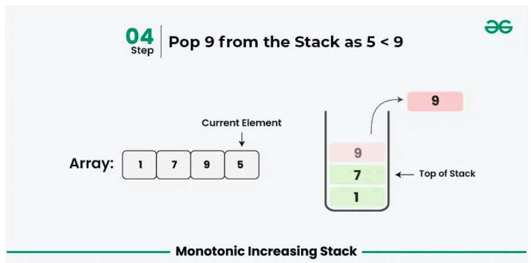
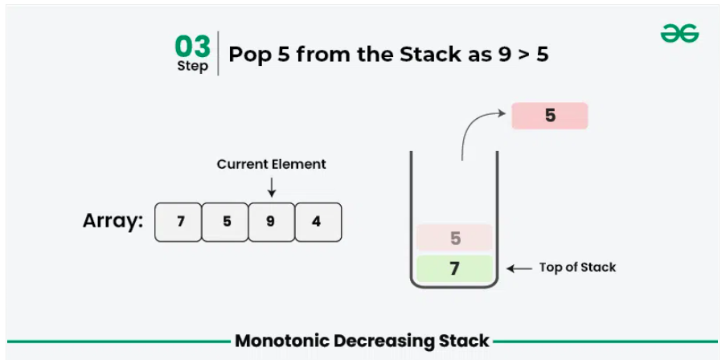

# STACK

# Monotonic Stack

A **monotonic** stack is a stack (LIFO data structure) that maintains its elements in either
**increasing** or **decreasing order**. It is commonly used in problems that involve finding the next greater or smaller
element efficiently.

# Types of Monotonic Stacks

1. Monotonic Increasing Stack(Stores elements in increasing order)
    - The top of the stack **always contains the smallest** element seen so far.
    - Before pushing a new element, we **pop all smaller elements**, ensuring the stack remains increasing.
    - **Used for: Next Greater Element** problems.

2. Monotonic Decreasing Stack(Stores elements in decreasing order)
    - The top of the stack **always contains the largest** element seen so far.
    - Before pushing a new element, we pop all larger elements, ensuring the stack remains decreasing.
    - **Used for: Next Smaller Element** problems.
